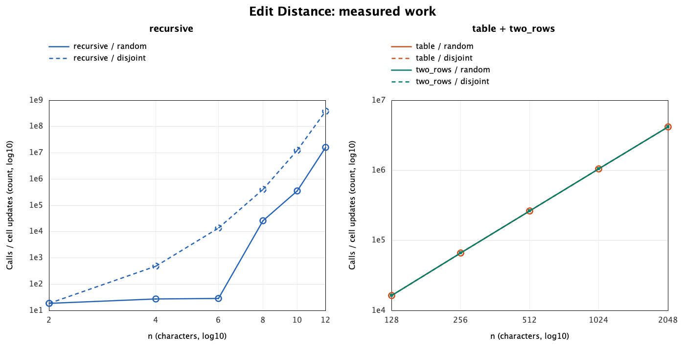
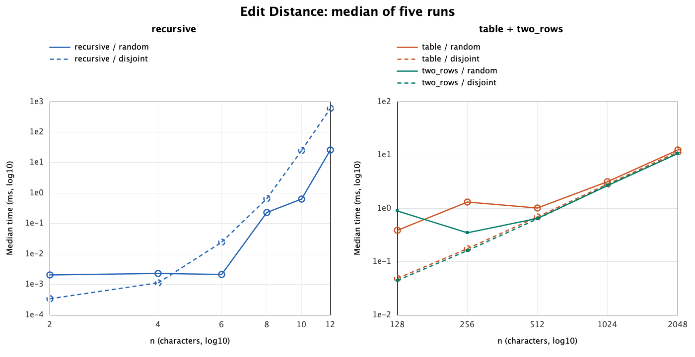
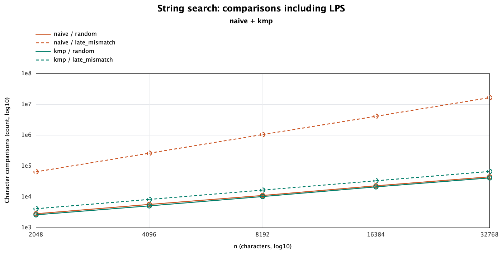
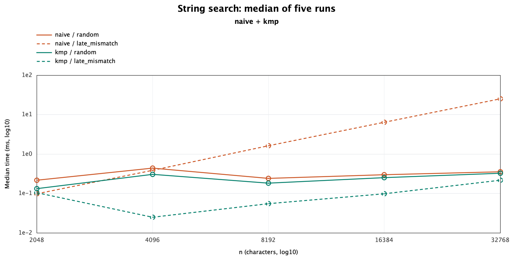

# Experiment Design Card

Written before the first experiment run; the initial Git commit preserves this plan.

| Field | Edit Distance | String search |
| --- | --- | --- |
| Question | How do recursion and DP scale, and do two rows preserve the table's work count? | Does KMP avoid Naive's repeated comparisons on a late mismatch? |
| Sizes | Recursive: 2, 4, 6, 8, 10, 12; table and two rows: 128, 256, 512, 1024, 2048. Both strings have length n. Small recursive sizes limit exponential work; DP sizes expose quadratic growth. | Text n = 2048, 4096, 8192, 16384, 32768; pattern m = n/64. Growing both lengths separates quadratic Naive from linear KMP. |
| Inputs | Random strings over abcd show typical mismatches. Disjoint a^n and b^n force all three recursive branches and every DP cell. | Random text and pattern over abcd, with the pattern inserted at n/4, n/2 and 3n/4, show ordinary search with known matches. Late mismatch: text a^n, pattern a^(m-1)b, forces long failed comparisons at every Naive start. |
| Metrics | Count recursive calls (including bases), or interior DP cell updates, inside each implementation. These are different work units, so compare their growth rather than treating a call as identical to a cell. Record time_ms for each of five measured runs and plot the median. | Count character comparisons, including KMP LPS construction. This captures repeated work and preprocessing. Record five runs and plot median time_ms. |
| Prediction | Disjoint recursion grows exponentially; random recursion is smaller. Both DP versions perform n^2 updates; two rows use linear auxiliary space. | Late-mismatch Naive grows as n*m; KMP grows as n+m. Random inputs need much less repeated work; KMP may have overhead at small sizes. |
| Plots | One work-count chart with log axes; one median-time chart with log axes. | One comparison-count chart with log axes; one median-time chart with log axes. Each distinguishes input and algorithm. |

Protocol: custom input generator backed by java.util.Random, seed 20261108;
fresh deterministic seed per family, input and size. Two unrecorded warm-up runs
per case, then five measured runs of the same input. Use System.nanoTime and
write one CSV row per measured run. Inputs, answers and counters must repeat;
wall-clock times naturally vary. Run sequentially and keep all measured runs.

The planned recursive limit is n=12, not an estimate of the largest feasible n.
Report the measured cost there and explain the practical exponential limit.

## Edit Distance: results and prediction

The disjoint recursive call count grows rapidly, while all four DP series overlap at exactly n^2 cell updates.

Recursion reaches 592.892 ms at n=12 on disjoint strings; DP handles n=2048 in roughly 11-12 ms, with noisy small-size timings.

The work counts confirm the prediction: disjoint recursion rises from 19 calls
at n=2 to 377,393,953 at n=12, whereas both DP versions do 4,194,304 updates
at n=2048 on either input type. Random recursion is not monotonic at small
sizes because each size uses a different pair; n=4 and n=6 both happen to
have distance 2. At n=12 it needs 16,253,599 calls and 25.957 ms, much less
than the disjoint case. Table and two-row random medians at n=2048 are
12.438 and 10.671 ms. Their equal counters establish equal update counts,
not a guarantee of equal runtime or a universal speed advantage.

## String search: results and prediction

Doubling n makes late-mismatch Naive comparisons grow about fourfold, while KMP comparisons grow about twofold including LPS.

At n=32768 the late-mismatch median is 25.074 ms for Naive and 0.216 ms for KMP, while smaller cases show timing irregularities.

The counters support the prediction. As n rises from 2048 to 32768,
late-mismatch Naive grows from 64,544 to 16,515,584 comparisons; KMP grows
from 4,126 to 66,046. The measured Naive count equals (n-m+1)*m, confirming
that every candidate fails only at the last character. At the largest size,
Naive uses about 250 times as many comparisons and about 116 times the time.
Random inputs give three matches at every size; at n=32768, Naive and KMP
use 44,312 and 40,570 comparisons and take 0.351 and 0.323 ms. Random search
is roughly linear here because most candidate starts fail quickly.

## Short answers

**Which search input was slowest, and why?**
Late mismatch at n=32768 was the slowest Naive case, with a 25.074 ms median.
Its long repeated prefix makes Naive compare all m characters at each start,
then repeat almost the same work one position later. KMP retains the valid
prefix length through LPS and never moves its text index backwards. For KMP,
the largest random input was slower than the largest late-mismatch input
(0.323 versus 0.216 ms), showing that comparison counts do not explain every
constant factor in time.

**How large an n could recursive Edit Distance handle?**
It completed n=12, the largest planned size, including all five measured runs
on disjoint strings. That case took 589.910-597.497 ms per run and
377,393,953 calls, versus 12,146,179 calls at n=10. The experiment stopped at
its predefined cap to bound exponential runtime; it did not encounter a
stack overflow or establish the machine's absolute maximum n.

**What do two rows gain and lose?**
Two rows preserve the answer and all n*m updates while reducing auxiliary
storage from O(n*m) to O(min(n,m)) by using the shorter string as columns.
At n=m=2048, integer payloads are 16,793,604 bytes for the full table and
16,392 bytes for two rows, excluding object headers; these are calculated
storage sizes, not measured memory counters. Discarding older rows loses the
stored path needed for straightforward edit-sequence reconstruction, so that
would require recomputation or a different reconstruction algorithm.

**Which search would suit the city platform?**
I would use KMP for exact pattern search in long logs because it gives
O(n+m) time even on repetitive input. It needs O(m) auxiliary space for LPS,
but avoids Naive's repeated comparisons and returns overlapping matches.
Typo correction is a separate task for Edit Distance; KMP itself does not
perform approximate matching.

## Time, validation and limits

Measurements used OpenJDK 25.0.1 on macOS 26.3.1 aarch64, with eight available
processors, two warm-ups per case and five sequential measured runs. Times
include allocations and counters, exclude input generation and CSV writing,
and include LPS construction for KMP. Medians are plotted without rounding to
integer milliseconds; every raw run is retained in results/results.csv.
For example, table/random drops from 1.318 ms at n=256 to 1.012 ms at n=512,
and KMP/late-mismatch drops from 0.105 ms at n=2048 to 0.025 ms at n=4096.
JIT compilation, branch predictability, allocation, garbage collection and
scheduling are plausible causes, but were not measured separately; two
warm-ups do not guarantee a steady-state JVM. Counters therefore provide
stronger evidence for growth than these short timings. One generated pair
per size and input type limits any claim about average random performance.

All 11 JUnit 5 tests pass, including the reference values, empty cases, public
LPS arrays, overlaps, 100 random Edit Distance pairs, 100 random search cases
also checked against String.indexOf, counter resets and generator checks.
A second complete experiment reproduced every non-time column in all 260
rows. The original design card and predictions were not changed after the
first run.
